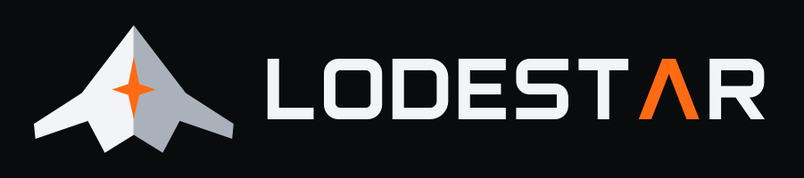
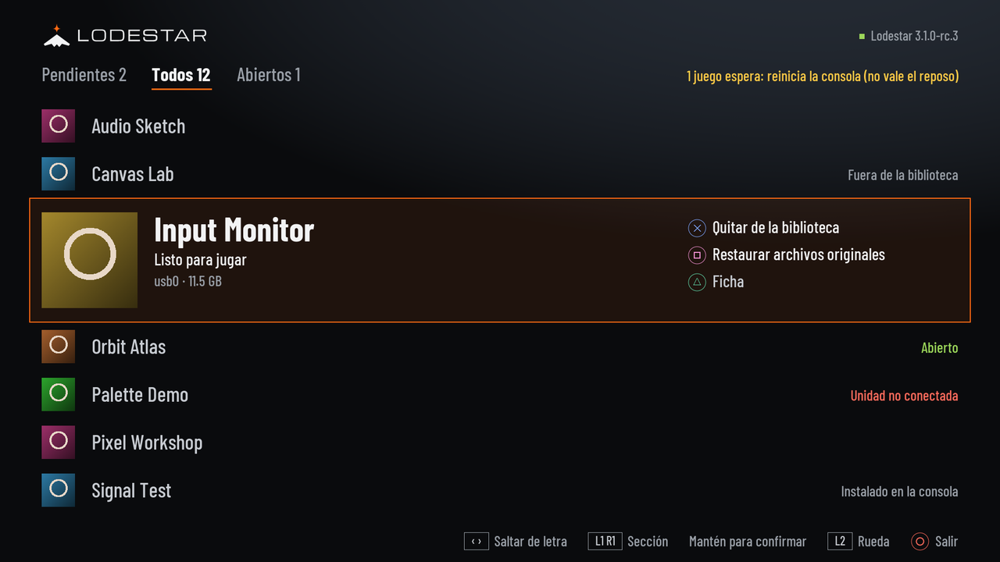
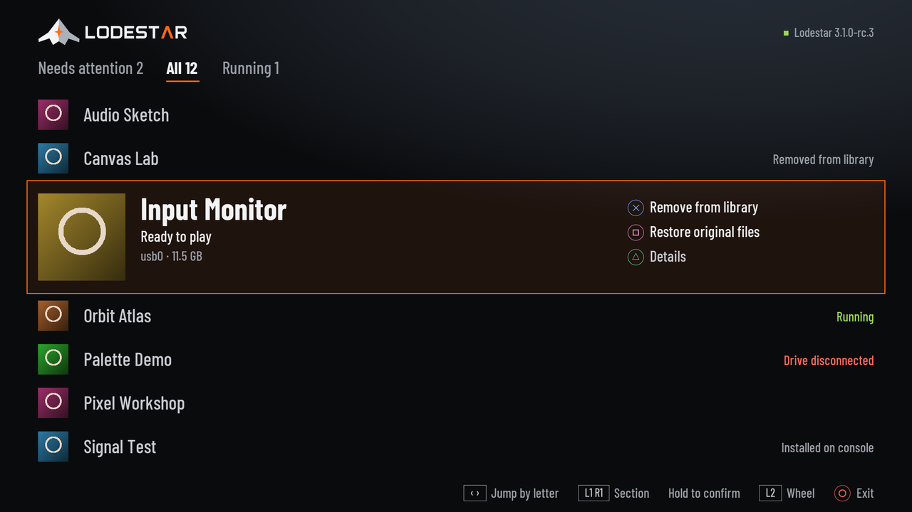

<p align="center"></p>

# Lodestar

**Organiza y monta tus paquetes locales de PS4 desde USB o el almacenamiento de la consola.**
**Organize and mount your local PS4 packages from USB or console storage.**

**[Empezar](#uso) · [Guía completa](docs/guia.md) · [Getting started](#use) · [User guide](docs/guide.md) · [Descargas / Downloads](https://github.com/felipebasurto/Lodestar-PS4/releases/tag/v3.1.0-rc.3)**

> [!NOTE]
> La **3.1.0-rc.3** es una versión de prueba: sus controles nuevos aún no se han probado en una PS4 real. Si vienes de la rc.2, lee antes las [notas de la versión](https://github.com/felipebasurto/Lodestar-PS4/releases/tag/v3.1.0-rc.3): cambian la carpeta del USB y el puerto del panel.
> **3.1.0-rc.3** is a test release: its new controls have not been tried on a real PS4 yet. Coming from rc.2, read the [release notes](https://github.com/felipebasurto/Lodestar-PS4/releases/tag/v3.1.0-rc.3) first: the USB folder and the panel port change.

Lodestar es un proyecto independiente para PS4, publicado como [felipebasurto/Lodestar-PS4](https://github.com/felipebasurto/Lodestar-PS4).
Lodestar is an independent PS4 project, published as [felipebasurto/Lodestar-PS4](https://github.com/felipebasurto/Lodestar-PS4).

**Independencia y atribución.** Lodestar nació como un port para PS4 de [PS4Mount](https://github.com/gasb07/ps4mount), de **gasb07** (para PS5), continuado después desde [Vld439/PS4Mount-PS4](https://github.com/Vld439/PS4Mount-PS4) y sus contribuidores; desde la versión 2.0.0 sigue su propio camino como proyecto independiente. Como exige la licencia GPL-3.0-or-later, conserva la atribución a gasb07/PS4Mount como proyecto origen, sus avisos de copyright y la misma licencia.

**Independence and attribution.** Lodestar began as a PS4 port of [PS4Mount](https://github.com/gasb07/ps4mount) by **gasb07** (for the PS5), then continued from [Vld439/PS4Mount-PS4](https://github.com/Vld439/PS4Mount-PS4) and its contributors; since version 2.0.0 it follows its own path as an independent project. As required by GPL-3.0-or-later, it keeps the attribution to gasb07/PS4Mount as the origin project, its copyright notices and the same license.

*Proyecto no oficial, sin relación con Sony Interactive Entertainment. PlayStation y PS4 son marcas de Sony Interactive Entertainment. Usa contenido propio o que tengas autorización para utilizar. Lodestar recibe los archivos que tú selecciones.*
*Unofficial project, not affiliated with Sony Interactive Entertainment. PlayStation and PS4 are trademarks of Sony Interactive Entertainment. Use content you own or are authorized to use. Lodestar receives files you select.*

---

<a name="español"></a>
# Español

Lodestar es un payload para una PS4 con jailbreak. Pones los pkgs del juego (y su actualización y sus DLC) en un disco USB o en la memoria de la consola, y Lodestar los añade a la pantalla de inicio para jugarlos **desde el pkg, sin instalarlos**: no hay que esperar a una instalación ni gastar espacio en una segunda copia.

Lodestar está centrado deliberadamente en discos duros USB y almacenamiento local. **No incluye Google Drive, NAS, SMB, NFS ni FUSE**: esas funciones se eliminaron para reducir superficie, dependencias y fallos difíciles de diagnosticar.

El panel web y la app de PS4 enseñan la biblioteca como una columna de juegos, en la que la fila elegida crece. La ficha de un juego se abre solo cuando la pides, sin ocupar permanentemente media pantalla con un panel de detalles.

El payload se ha probado en **13.52** y **14.00** con GoldHEN. El panel y las notificaciones están en **español e inglés**: salen en el idioma de la consola (inglés si no es ninguno de los dos), y se puede cambiar en **Ajustes → Idioma**.

> [!WARNING]
> **Versión beta.** Haz una copia de seguridad de tus partidas guardadas antes de usarlo, y [cuenta cualquier problema](#problemas-frecuentes) con el log.

> [!NOTE]
> **Convivencia con PS4Mount.** Lodestar usa identidad propia: `/data/lodestar/` (ajustes, log y estado), la carpeta `Lodestar` de los USB, `/data/Lodestar` en la memoria interna, el panel en el puerto 8780 y la app `LODS00001`. No migra ni borra `/data/ps4mount`, `/system_data/ps4mount`, la carpeta `PS4Mount` ni la app `PSMT00001`. Los dos gestores no deben ejecutarse a la vez porque ambos controlan montajes globales de la consola: detén PS4Mount antes de cargar Lodestar. Los pkgs ya organizados en `<USB>/ps4/<TID>` siguen siendo biblioteca reutilizable; Lodestar reconstruye sus propios registros. La cabecera canónica del protocolo es `X-Lodestar`; `X-PS4Mount` solo se acepta como alias para clientes antiguos.


## Qué funciona y qué no

| | Estado |
| --- | --- |
| Juegos desde un **USB exFAT** (también pkgs de más de 4 GB) |  Probado |
| Juegos desde la **memoria interna** (`/data/Lodestar`) |  Probado: opcional, activado por defecto; los juegos instalados en la consola de la forma normal se detectan y no se tocan |
| **Actualizaciones** |  Probado |
| Juegos **donde están**, sin mover ni renombrar los pkgs (cualquier carpeta de la unidad) |  Probado |
| **DLC externos** (`dlc_mode=external`, por defecto) |  Probado con los DLC de Modern Warfare 3 y Black Ops 6: el paquete se monta desde su unidad y los metadatos se guardan en la consola. Otros juegos, sin probar |
| DLC **instalados** (`dlc_mode=internal`) |  Probado: se instalan con el instalador del sistema y ocupan memoria interna. Los de más de 256 MB también, salvo que desmarques **Instalar también los DLC grandes** (marcado por defecto); sin esa opción no se usan |
| DLC **apagados** (`dlc_mode=off`) |  No se usan |
| **Enviar paquetes desde el PC** por la red local, con comprobación previa |  Probado (unos 16 MB/s por cable) |
| **Importar desde URL**: un pkg, un ZIP o un RAR (también en partes y con contraseña) |  Probado en la consola |
| **Extensión del navegador**: las transferencias de pkg, ZIP y RAR van a la consola |  Probado en Brave; Firefox sin probar |
| **Borrar** un juego desde la consola |  Probado: borra también sus pkgs y libera el espacio |
| Un juego **nuevo**, o una actualización que llega después del juego |  Necesita **reiniciar la consola una vez**; después se juega siempre |
| **Ports homebrew** (juegos sin CUSA, como `SMWR00001` o `SSBU00001`) |  Probado si pesan **1 GB o más** |
| Apps homebrew de menos de 1 GB |  No se juegan desde el pkg, pero **Enviar paquetes** las instala en la consola |
| **Clásicos de PS1, PS2 y PSP** empaquetados como pkg de PS4 |  Se reconocen y se montan; arranque pendiente de verificar en consola |
| **ROM de emuladores** sin copiarlas a la consola |  Pendiente de verificar en consola |
| Paquetes comerciales de PlayStation Store |  No |
| Google Drive, NAS, SMB, NFS o FUSE |  Eliminado deliberadamente |

## Requisitos

- Una PS4 con jailbreak y **GoldHEN** (con su BinLoader activado, el puerto 9090).
- Una forma de cargar payloads: **Payloader/Launchpad** de GoldHEN (recomendado), Payload Guest, o **Ajustes → Arrancar con la consola** en el panel.
- Paquetes `.pkg` de PS4 compatibles que tengas derecho a usar, como aplicaciones homebrew.
- Para jugar desde USB: un disco formateado en **exFAT**. Mejor un **SSD**: con un disco duro mecánico algunos juegos cargan lento (ver [Rendimiento](#rendimiento-disco-duro-mecánico-o-ssd)).

## Uso

La explicación completa, con capturas de cada pantalla, está en la **[guía de uso](docs/guia.md)**.

### Primera vez

1. **Descarga** [`lodestar-ps4.bin`](https://github.com/felipebasurto/Lodestar-PS4/releases/download/v3.1.0-rc.3/lodestar-ps4.bin) y cópialo en **`/data/payloads/`** de la consola.
2. **Carga Lodestar.** Aparece una notificación con `Lodestar <versión> en marcha` y la dirección del panel. Hay que repetirlo **después de cada arranque**, salvo que actives **Arrancar con GoldHEN**.
3. **Abre la app o el panel** (`http://<IP de la PS4>:8780`), elige los ajustes y **guarda**. Hasta entonces no se añade ningún juego; si nadie los abre en 2 minutos, se usan los ajustes por defecto.
4. **Pon los juegos** (con su actualización y sus DLC):
   - **En un USB:** en la carpeta `Lodestar` de la unidad, y conéctalo.
   - **En la memoria interna:** en `/data/Lodestar`, por FTP.
   - **Desde el panel:** con **Enviar paquetes**, por la red local.
5. Si un juego queda como **Reinicia para jugar**, reinicia una vez (el modo reposo no vale) y vuelve a cargar Lodestar.
6. Juega desde la pantalla de inicio.

> [!IMPORTANT]
> Con **Organizar** activado (por defecto), Lodestar **mueve y renombra** los pkgs a `ps4/<ID del juego>/` en su unidad. Desactívalo antes de guardar si no quieres que toque tus archivos. **Restaurar archivos originales** los devuelve.

### La app de PS4

La app se instala sola cuando hay una release de la versión y la consola tiene internet. Si no, instala [`lodestar-panel.pkg`](https://github.com/felipebasurto/Lodestar-PS4/releases/download/v3.1.0-rc.3/lodestar-panel.pkg) con el instalador de paquetes de GoldHEN. Usa `LODS00001` y aparece como un icono separado llamado **Lodestar**; no reemplaza la app `PSMT00001` de PS4Mount. Necesita el payload cargado.



| Botón | Qué hace |
| --- | --- |
| **↑ ↓** o stick izquierdo | Recorrer la biblioteca |
| **← →** | Saltar a la inicial anterior o siguiente |
| **L1 / R1** | Cambiar de sección: Pendientes, Todos, Abiertos |
| Mantener **✕** | Añadir o quitar el juego |
| Mantener **□** | Restaurar sus archivos originales |
| **△** | Ficha: ID, versión, DLC, firmware, tamaño y ubicación |
| Mantener **L2**, apuntar y soltar | Rueda: Buscar juegos, Enviar paquetes, Transferencias, Ajustes, Buscar por nombre, Salir |
| **○** | Volver, borrar la búsqueda o salir |

Añadir, quitar y restaurar piden mantener el botón hasta que se llena la barra naranja; si lo sueltas antes, no pasa nada. En **Ajustes**, nada se aplica hasta elegir **Guardar ajustes**.

La compilación y las pruebas de host están verificadas. La [validación en una PS4 real](https://github.com/felipebasurto/Lodestar-PS4/issues/13) sigue pendiente.

### El panel web

Para el móvil y el PC: `http://<IP de la PS4>:8780`. No tiene contraseña.

- **Arriba**: **Buscar juegos** (vuelve a mirar las unidades), **Enviar paquetes**, **Importar desde URL**, la campana de notificaciones y **Más** (Ajustes, Quitar varios, Log y Detener).
- **Encima de la biblioteca**: el buscador, los filtros por estado (Listo para jugar, Reinicia para jugar, Unidad no conectada…) y por plataforma, y el espacio libre de cada unidad.
- **La biblioteca**: un juego por fila, ordenados por título; la fila elegida crece. Al pulsar un juego se abre su ficha: versión, DLC, firmware que necesita, dónde están sus pkgs y las acciones (quitar o añadir a la biblioteca, restaurar sus archivos originales).
- **Ajustes**: biblioteca (carpetas, organizar, memoria interna, grupos), DLC, consola (idioma, AutoRun, log del sistema), lo que Lodestar ocupa en la consola y restaurar archivos originales.

En la pantalla de inicio, cada juego aparece como cualquier otro. Lodestar avisa con notificaciones al cargarse, al encontrar y añadir juegos, si falta el disco de un juego, al borrar uno y cuando hace falta reiniciar.

### Por qué hay que reiniciar una vez

La consola solo prepara algunos juegos nuevos al arrancar. Cuando Lodestar registra un juego nuevo, o una actualización llega después del juego, la consola pide reiniciar una vez. Después ese juego queda listo para los arranques siguientes.

### API para agentes y scripts

El panel es también una API HTTP en el puerto **8780**. `GET /api/agent` devuelve el manifiesto completo de rutas, cabeceras y límites de seguridad en JSON; `GET /api/status` devuelve un estado ligero sin enumerar la biblioteca. Las peticiones que escriben necesitan la cabecera `X-Lodestar: 1` (`X-PS4Mount: 1` se acepta como alias legacy) y solo se aceptan desde la red local. La tabla completa está en [AI-WORKFLOW.md](AI-WORKFLOW.md).

### Enviar paquetes desde el PC


1. Pulsa **Enviar paquetes**.
2. Elige el pkg o arrástralo al panel.
3. Lodestar comprueba antes de enviarlo que el paquete es compatible con esa consola.
4. Elige destino: una unidad USB o la memoria interna.

### Importar archivos desde URL


Lodestar puede importar los archivos que indiques mediante una URL directa:

- un `.pkg` directo;
- un `.zip`;
- un `.rar`, incluidos RAR en partes y RAR con contraseña.

Pega la URL del archivo en **Importar desde URL** y elige la unidad de destino. La consola recibe el archivo y extrae el contenido si está comprimido. Una descarga interrumpida se reanuda al cargar Lodestar otra vez.

### Extensión del navegador

`lodestar-extension.zip` en Releases contiene una extensión para navegadores de escritorio. Cuando la activas, la extensión envía las transferencias de `.pkg`, `.zip` y `.rar` del navegador a Lodestar en tu consola.

### ROM de emuladores

Para ROM usadas por apps homebrew como PS4SX2/PCSX2:

1. Abre la app una vez en la consola para que cree su carpeta en `/data`.
2. En el USB crea `Lodestar/emulators/<App>/<Carpeta>`, por ejemplo `Lodestar/emulators/PCSX2/games`.
3. Lodestar la expone como `/data/<App>/<Carpeta>` solo si la carpeta de la consola existe y está vacía; nunca tapa archivos de la consola.

### Borrar un juego

Al borrar un juego añadido por Lodestar desde la pantalla de inicio, Lodestar borra también sus pkgs de la biblioteca para liberar espacio. Si el juego está en su carpeta `ps4/<ID>/`, se borra **la carpeta entera**, con todo lo que hayas metido dentro. Los pkgs usados donde tú los dejaste (con **Organizar** desactivado, fuera de esa carpeta) se conservan. Los juegos instalados de forma normal no se tocan. **Quitar de la biblioteca** en el panel solo lo quita de la consola y conserva los pkgs.

## Ajustes y datos en la consola

- `/data/lodestar/config.txt`: ajustes.
- `/data/lodestar/log.txt`: log legible.
- `/data/lodestar/log.txt.old`: log anterior.
- `/data/lodestar/<CUSA…>.src`: de dónde salió cada juego.
- `/data/lodestar/stop`: si existe, Lodestar se detiene.

## Rendimiento: disco duro mecánico o SSD

Lodestar lee los juegos directamente de los pkgs del USB, así que la velocidad depende del disco. Un **SSD** evita los desplazamientos del cabezal. Las cifras de abajo se midieron solo en el HDD. Con un **disco duro mecánico**, los juegos que leen a la vez su actualización y varios DLC pueden cargar lento: cada cambio de archivo mueve el cabezal, y si los archivos están lejos unos de otros en el plato, ese movimiento es casi todo el disco.

Medido en la consola con un disco duro de 2.5" lleno al 91 %, donde la actualización y los DLC de un juego quedaron a 400-450 GB unos de otros ([#1](https://github.com/felipebasurto/Lodestar-PS4/issues/1)):

| | Velocidad |
| --- | --- |
| Un solo archivo seguido | ~92 MiB/s |
| Actualización + 4 DLC a la vez | ~22 MiB/s en total |

Lodestar no puede cambiar dónde están los archivos en el disco. Qué puedes hacer:

1. **Usar un SSD USB** para reducir la latencia al alternar entre archivos.
2. Con un disco duro: copia cada juego **con su actualización y sus DLC juntos y seguidos**, en un disco con mucho espacio libre (mejor recién formateado). No llenes el disco hasta el final.
3. Para ver cómo están los archivos de un juego en tu disco, conéctalo a un Mac o Linux, desmóntalo y ejecuta `sudo python3 tools/exfatmap.py /dev/rdiskN <ruta del pkg>...` (solo lee).

## Problemas frecuentes

### El panel no abre

Comprueba que la notificación de arranque apareció y que estás usando la IP de la consola con el puerto `8780`. El panel no tiene contraseña: úsalo solo en una red local de confianza.

### Un juego no aparece

Pulsa **Buscar juegos** y espera a que termine la pasada. Si sigue sin aparecer, copia `/data/lodestar/log.txt` por FTP y ejecútalo con:

```sh
python3 tools/logcheck.py log.txt
```

El explicador está en español por defecto; usa `--lang en` para inglés.

### Falta el disco de un juego

Lodestar conserva la entrada en la pantalla de inicio, pero el juego no arranca hasta volver a conectar la unidad donde están sus pkgs. No muevas los pkgs manualmente mientras la consola los está usando.

## Problemas conocidos

Los fallos conocidos y las mejoras pendientes están en [Issues](https://github.com/felipebasurto/Lodestar-PS4/issues). Los principales:

- [#1](https://github.com/felipebasurto/Lodestar-PS4/issues/1) Carga lenta con discos duros mecánicos cuando un juego lee la actualización y varios DLC a la vez.
- [#7](https://github.com/felipebasurto/Lodestar-PS4/issues/7) Un juego nuevo necesita reiniciar la consola una vez.
- [#4](https://github.com/felipebasurto/Lodestar-PS4/issues/4), [#5](https://github.com/felipebasurto/Lodestar-PS4/issues/5) Clásicos de PS1/PS2/PSP y ROM de emuladores: falta comprobarlos en consola.
- [#11](https://github.com/felipebasurto/Lodestar-PS4/issues/11) Solo probado en los firmwares 13.52 y 14.00.

## Desarrollo

Las reglas para agentes y personas que modifiquen el código están en [AGENTS.md](AGENTS.md) y [AI-WORKFLOW.md](AI-WORKFLOW.md). Las decisiones de comportamiento viven en `specs/`. Antes de cada commit:

```sh
bash test/run.sh
bash test/policy.sh
bash test/sdkcheck.sh
(cd test/web && npm test)
```

| Carpeta | Contenido |
| --- | --- |
| `src/` | El payload en C (escaneo, registro, montajes, panel HTTP, descargas) |
| `web/` | El panel: `index.html`, `legacy.html` (navegador de la PS4) y las traducciones |
| `panel-app/` | App nativa de PS4 (OpenOrbis, VideoOut y cliente de la API) |
| `extension/` | La extensión del navegador |
| `specs/` | Las reglas de comportamiento, por área |
| `test/` | Pruebas en el PC (C, Python y el panel en jsdom) |
| `tools/` | `logcheck.py` (explica el log), `exfatmap.py` (mapa de un disco exFAT), `benchdisk` |
| `evidence/` | Mediciones hechas en consola |

---

<a name="english"></a>
# English

Lodestar is a payload for a jailbroken PS4. Put a game's packages (with its update and DLC) on a USB drive or in the console's storage, and Lodestar adds it to the home screen to play it **straight from the pkg, without installing it**: no install wait and no second copy.

Lodestar is deliberately focused on USB hard drives and local storage. **It does not include Google Drive, NAS, SMB, NFS or FUSE**: those features were removed to reduce surface area, dependencies and hard-to-diagnose failures.

The web panel and the PS4 app show the library as one column of games, where the chosen row grows. A game's details open only on demand instead of a permanent details pane taking half the screen.


The payload has been tested on firmware **13.52** and **14.00** with GoldHEN. The panel and notifications are in **Spanish and English**: they follow the console language (English when it is neither), and can be changed in **Settings → Language**.

> [!WARNING]
> **Beta software.** Back up your saved games before using it, and [report problems](#frequent-problems) with the log.

> [!NOTE]
> **Side-by-side with PS4Mount.** Lodestar has its own operational identity: `/data/lodestar/` (settings, log and state), the USB `Lodestar` folder, `/data/Lodestar` in internal storage, panel port 8780 and app title `LODS00001`. It does not migrate or delete `/data/ps4mount`, `/system_data/ps4mount`, the `PS4Mount` folder or app title `PSMT00001`. The two mount daemons must not run at once because both control console-wide mounts: stop PS4Mount before loading Lodestar. Packages already organized in `<USB>/ps4/<TID>` remain reusable library data; Lodestar rebuilds its own records. The canonical protocol header is `X-Lodestar`; `X-PS4Mount` is accepted only as a legacy alias.

## What works and what does not

| | Status |
| --- | --- |
| Games from an **exFAT USB drive** (including pkgs over 4 GB) |  Tested |
| Games from **internal storage** (`/data/Lodestar`) |  Tested: optional, on by default; normally installed games are detected and not touched |
| **Updates** |  Tested |
| Games **where they are**, without moving or renaming pkgs |  Tested |
| **External DLC** (`dlc_mode=external`, the default) |  Tested with the add-ons of Modern Warfare 3 and Black Ops 6: packages are mounted from their drive while metadata stays on the console. Other games untested |
| **Installed DLC** (`dlc_mode=internal`) |  Tested: installed through the system installer; they use internal storage. Those over 256 MB are installed too unless you untick **Also install big add-ons** (ticked by default); without it they are not used |
| **DLC off** (`dlc_mode=off`) |  Not used |
| **Sending packages from a PC** over the local network, with preflight validation |  Tested (about 16 MB/s wired) |
| **Importing from a URL**: a pkg, ZIP or RAR (including parts and passwords) |  Tested on console |
| **Browser extension**: pkg, ZIP and RAR transfers go to the console |  Tested in Brave; Firefox untested |
| **Deleting** a game from the console |  Tested: also deletes its pkgs and frees the space |
| A **new** game, or an update arriving after the game |  Needs **one console restart**; then it stays ready |
| **Homebrew ports** (non-CUSA games such as `SMWR00001` or `SSBU00001`) |  Tested when they are **1 GB or larger** |
| Homebrew apps under 1 GB |  Not playable straight from pkg, but **Send packages** installs them on the console |
| **PS1, PS2 and PSP classics** packaged as PS4 pkgs |  Recognized and mounted; launch verification pending |
| **Emulator ROMs** without copying them to the console |  Console verification pending |
| Commercial PlayStation Store packages |  No |
| Google Drive, NAS, SMB, NFS or FUSE |  Deliberately removed |

## Requirements

- A jailbroken PS4 with **GoldHEN** (BinLoader enabled, port 9090).
- A way to load payloads: GoldHEN **Payloader/Launchpad** (recommended), Payload Guest, or the panel's **Start with the console** setting.
- Compatible PS4 `.pkg` files you are authorized to use, such as homebrew applications.
- For USB play: an **exFAT** formatted drive. An **SSD** is best: with a spinning hard drive some games load slowly (see [Performance](#performance-hard-drive-or-ssd)).

## Use

The full explanation, with a screenshot of every screen, is in the **[user guide](docs/guide.md)**.

### First time

1. **Download** [`lodestar-ps4.bin`](https://github.com/felipebasurto/Lodestar-PS4/releases/download/v3.1.0-rc.3/lodestar-ps4.bin) and copy it to **`/data/payloads/`** on the console.
2. **Load Lodestar.** A notification shows `Lodestar <version> running` and the panel address. Do it again **after every boot**, unless you turn on **Start with GoldHEN**.
3. **Open the app or the panel** (`http://<PS4 IP>:8780`), choose the settings and **save**. No game is added until then; if nobody opens either for 2 minutes, the default settings are used.
4. **Add games** (with their update and add-ons):
   - **USB:** in the drive's `Lodestar` folder, then connect it.
   - **Internal storage:** in `/data/Lodestar`, over FTP.
   - **Panel:** with **Send packages**, over the local network.
5. If a game shows **Restart to play**, restart once (rest mode does not count) and load Lodestar again.
6. Play from the home screen.

> [!IMPORTANT]
> With **Organize** on (the default), Lodestar **moves and renames** pkgs to `ps4/<title ID>/` on their drive. Turn it off before saving if you do not want it to touch your files. **Restore original files** puts them back.

### The PS4 app

The app installs itself when there is a release for the version and the console has internet. Otherwise install [`lodestar-panel.pkg`](https://github.com/felipebasurto/Lodestar-PS4/releases/download/v3.1.0-rc.3/lodestar-panel.pkg) with GoldHEN’s Package Installer. It uses `LODS00001` and appears as a separate tile named **Lodestar**; it does not replace PS4Mount’s `PSMT00001` app. It needs the payload loaded.



| Button | What it does |
| --- | --- |
| **↑ ↓** or left stick | Walk the library |
| **← →** | Jump to the previous or next initial |
| **L1 / R1** | Change section: Needs attention, All, Running |
| Hold **Cross** | Add or remove the game |
| Hold **Square** | Restore its original files |
| **Triangle** | Details: ID, version, add-ons, firmware, size and location |
| Hold **L2**, point and release | Wheel: Scan for games, Send packages, Transfers, Settings, Search by name, Exit |
| **Circle** | Back, clear the search or exit |

Adding, removing and restoring need the button held until the orange bar fills; release it earlier and nothing happens. In **Settings**, nothing is applied until you choose **Save settings**.

The package builds and the host checks pass. [PS4 hardware validation](https://github.com/felipebasurto/Lodestar-PS4/issues/13) is still pending.

### The web panel

For phones and PCs: `http://<PS4 IP>:8780`. It has no password.

- **Top**: **Scan for games** (looks at the drives again), **Send packages**, **Import from URL**, the notifications bell and **More** (Settings, Remove several, Log and Stop).
- **Above the library**: the search field, the filters by state (Ready to play, Restart to play, Drive not connected…) and by platform, and each drive's free space.
- **The library**: one game per row, in title order; the chosen row grows. Choosing a game opens its details: version, add-ons, required firmware, where its pkgs are, and its actions (remove from or add to the library, restore its original files).
- **Settings**: library (folders, organize, internal storage, groups), add-ons, console (language, AutoRun, system log), what Lodestar keeps on the console, and restoring original files.

On the home screen each game looks like any other. Lodestar notifies when it loads, when games are found and added, when a game's drive is missing, when one is deleted, and when an action needs a restart.

### Why one restart is needed

The console prepares some new games only during boot. When Lodestar registers a new game, or an update arrives after the game, the console asks for one restart. After that, the game remains ready across boots.

### Agent and script API

The panel is also an HTTP API on port **8780**. `GET /api/agent` returns the complete route, header and safety manifest as JSON; `GET /api/status` returns a lightweight state without listing the library. Write requests need the `X-Lodestar: 1` header (`X-PS4Mount: 1` is accepted as a legacy alias) and are accepted only from the local network. The full route table is in [AI-WORKFLOW.md](AI-WORKFLOW.md).

### Sending packages from a PC

1. Choose **Send packages**.
2. Pick a pkg or drag it into the panel.
3. Lodestar checks before upload whether the package is compatible with that console.
4. Choose the destination: a USB drive or internal storage.

### Importing files from a URL

Lodestar can import files from a direct URL you supply:

- a direct `.pkg`;
- a `.zip`;
- a `.rar`, including multipart and password-protected RAR archives.

Paste the file URL in **Import from URL** and choose a destination. The console transfers the file and extracts the contents if it is an archive. An interrupted download resumes when Lodestar is loaded again.

### Browser extension

`lodestar-extension.zip` in Releases contains a desktop browser extension. When enabled, the extension forwards `.pkg`, `.zip` and `.rar` transfers from the browser to Lodestar on your console.

### Emulator ROMs

For ROMs used by homebrew apps such as PS4SX2/PCSX2:

1. Open the app once on the console so it creates its folder in `/data`.
2. On the USB drive create `Lodestar/emulators/<App>/<Folder>`, for example `Lodestar/emulators/PCSX2/games`.
3. Lodestar exposes it as `/data/<App>/<Folder>` only if the console folder exists and is empty; it never covers console files.

### Deleting a game

Deleting a Lodestar-added game from the home screen also deletes its library pkgs to free space. If the game is in its `ps4/<ID>/` folder, **the whole folder** is deleted, with anything you put in it. Pkgs used where you left them (with **Organize** off, outside that folder) are kept. Normally installed games are not touched. **Remove from library** in the panel only unregisters it and keeps the pkgs.

## Settings and data on the console

- `/data/lodestar/config.txt`: settings.
- `/data/lodestar/log.txt`: readable log.
- `/data/lodestar/log.txt.old`: previous log.
- `/data/lodestar/<CUSA…>.src`: where each game came from.
- `/data/lodestar/stop`: if present, Lodestar stops.

## Performance: hard drive or SSD

Lodestar reads games straight from the pkgs on the drive, so speed depends on the drive. An **SSD** removes mechanical seek time. The figures below were measured on the HDD only. With a **spinning hard drive**, games that read their update and several add-ons at once can load slowly: every switch between files moves the head, and when the files are far apart on the platter that move crosses almost the whole disk.

Measured on the console with a 2.5" hard drive 91% full, where a game's update and add-ons ended up 400-450 GB apart ([#1](https://github.com/felipebasurto/Lodestar-PS4/issues/1)):

| | Speed |
| --- | --- |
| One file, read in order | ~92 MiB/s |
| Update + 4 add-ons at once | ~22 MiB/s in total |

Lodestar cannot change where files sit on the disk. What you can do:

1. **Use a USB SSD** to reduce latency when reads switch between files.
2. With a hard drive: copy each game **with its update and add-ons together, one after the other**, onto a drive with plenty of free space (freshly formatted is best). Do not fill the drive to the end.
3. To see where a game's files are on your drive, connect it to a Mac or Linux machine, unmount it and run `sudo python3 tools/exfatmap.py /dev/rdiskN <pkg path>...` (read only).

## Frequent problems

### The panel does not open

Check that the startup notification appeared and that you are using the console IP with port `8780`. The panel has no password: use it only on a trusted local network.

### A game does not appear

Choose **Scan for games** and wait for the pass to finish. If it still does not appear, copy `/data/lodestar/log.txt` over FTP and run:

```sh
python3 tools/logcheck.py log.txt --lang en
```

### A game's drive is missing

Lodestar keeps the home-screen entry, but the game does not launch until the drive containing its pkgs is connected again. Do not move packages manually while the console is using them.

## Known issues

Known bugs and pending improvements are in [Issues](https://github.com/felipebasurto/Lodestar-PS4/issues). The main ones:

- [#1](https://github.com/felipebasurto/Lodestar-PS4/issues/1) Slow loading on spinning hard drives when a game reads its update and several add-ons at once.
- [#7](https://github.com/felipebasurto/Lodestar-PS4/issues/7) A new game needs one console restart.
- [#4](https://github.com/felipebasurto/Lodestar-PS4/issues/4), [#5](https://github.com/felipebasurto/Lodestar-PS4/issues/5) PS1/PS2/PSP classics and emulator ROMs still need console verification.
- [#11](https://github.com/felipebasurto/Lodestar-PS4/issues/11) Only tested on firmware 13.52 and 14.00.

## Development

Rules for agents and people changing the code are in [AGENTS.md](AGENTS.md) and [AI-WORKFLOW.md](AI-WORKFLOW.md). Behavior decisions live in `specs/`. Before every commit:

```sh
bash test/run.sh
bash test/policy.sh
bash test/sdkcheck.sh
(cd test/web && npm test)
```

| Folder | Contents |
| --- | --- |
| `src/` | The payload in C (scan, registration, mounts, HTTP panel, downloads) |
| `web/` | The panel: `index.html`, `legacy.html` (the PS4's browser) and translations |
| `assets/` | The identity: `render_icons.py` draws the mark, wordmark and artwork; `render_web_theme.py` packs the font for the web panel |
| `panel-app/` | Native PS4 app (OpenOrbis, VideoOut and the API client) |
| `extension/` | The browser extension |
| `specs/` | Behavior rules, by area |
| `test/` | Host tests (C, Python and the panel in jsdom) |
| `tools/` | `logcheck.py` (explains the log), `exfatmap.py` (maps an exFAT drive), `benchdisk` |
| `evidence/` | Measurements taken on the console |

The menus use [Barlow Condensed](https://github.com/jpt/barlow), SIL Open Font License 1.1 (`third_party/barlow/OFL.txt`). The wordmark is outlined from [Michroma](https://github.com/googlefonts/Michroma-font), under the same licence (`third_party/michroma/OFL.txt`).
