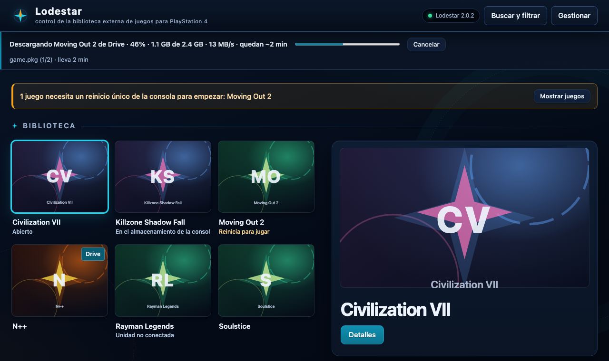
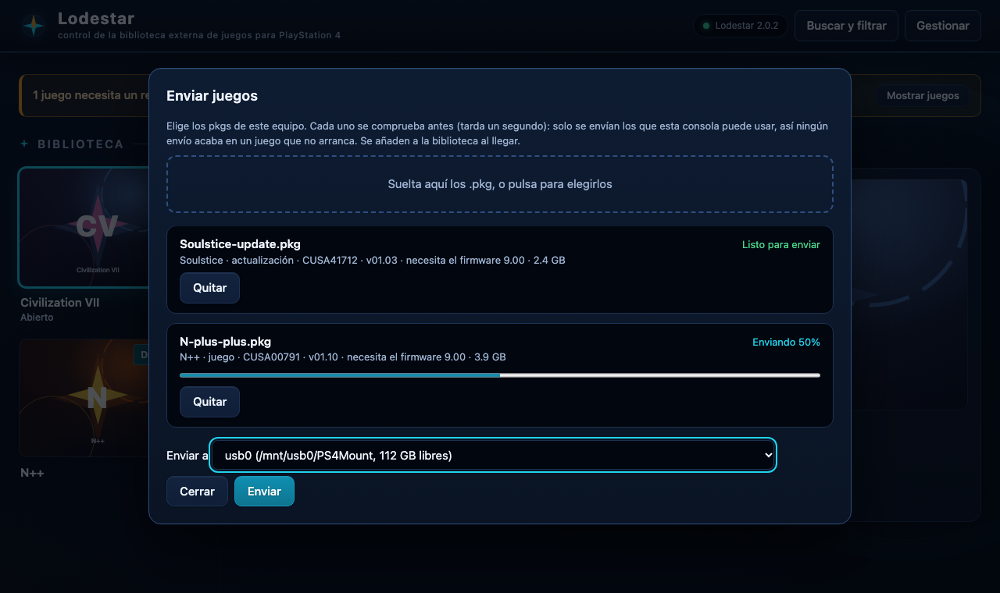
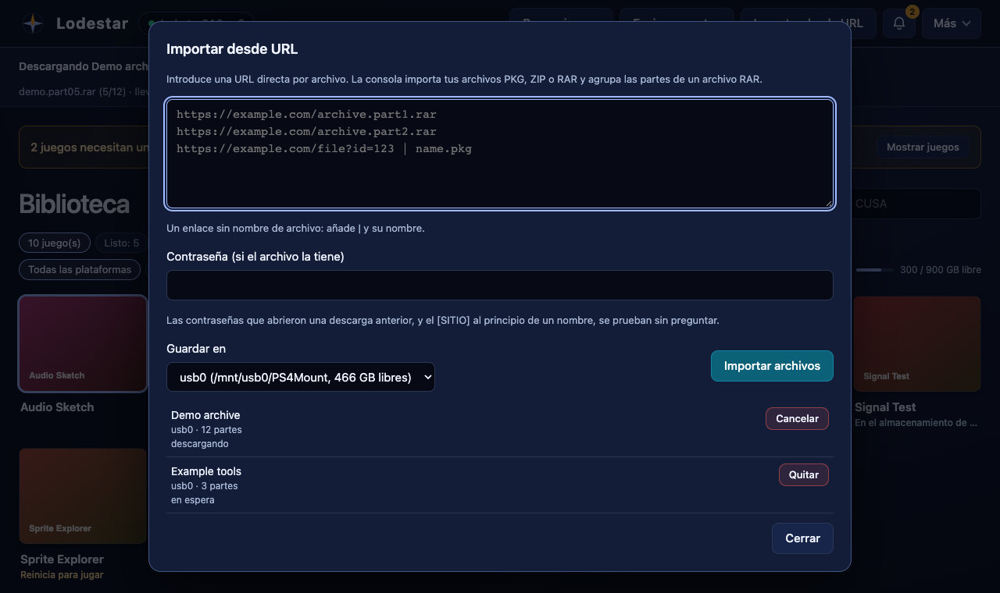

<p align="center"></p>

# Lodestar

**Juega pkgs fake de PS4 desde discos USB o la memoria de la consola, sin instalarlos.**
**Play PS4 fake pkgs from USB drives or the console's storage, without installing them.**

**[Español](#español) · [English](#english)**

Lodestar es un proyecto independiente para PS4, publicado como [felipebasurto/Lodestar-PS4](https://github.com/felipebasurto/Lodestar-PS4).
Lodestar is an independent PS4 project, published as [felipebasurto/Lodestar-PS4](https://github.com/felipebasurto/Lodestar-PS4).

**Independencia y atribución.** Lodestar nació como un port para PS4 de [PS4Mount](https://github.com/gasb07/ps4mount), de **gasb07** (para PS5), continuado después desde [Vld439/PS4Mount-PS4](https://github.com/Vld439/PS4Mount-PS4) y sus contribuidores; desde la versión 2.0.0 sigue su propio camino como proyecto independiente. Como exige la licencia GPL-3.0-or-later, conserva la atribución a gasb07/PS4Mount como proyecto origen, sus avisos de copyright y la misma licencia.

**Independence and attribution.** Lodestar began as a PS4 port of [PS4Mount](https://github.com/gasb07/ps4mount) by **gasb07** (for the PS5), then continued from [Vld439/PS4Mount-PS4](https://github.com/Vld439/PS4Mount-PS4) and its contributors; since version 2.0.0 it follows its own path as an independent project. As required by GPL-3.0-or-later, it keeps the attribution to gasb07/PS4Mount as the origin project, its copyright notices and the same license.

*Proyecto no oficial, sin relación con Sony Interactive Entertainment. PlayStation y PS4 son marcas de Sony Interactive Entertainment. Úsalo solo con juegos que te pertenecen.*
*Unofficial project, not affiliated with Sony Interactive Entertainment. PlayStation and PS4 are trademarks of Sony Interactive Entertainment. Only use it with games you own.*

---

<a name="español"></a>
# Español

Lodestar es un payload para una PS4 con jailbreak. Pones los pkgs del juego (y su actualización y sus DLC) en un disco USB o en la memoria de la consola, y Lodestar los añade a la pantalla de inicio para jugarlos **desde el pkg, sin instalarlos**: no hay que esperar a una instalación ni gastar espacio en una segunda copia.

Lodestar está centrado deliberadamente en discos duros USB y almacenamiento local. **No incluye Google Drive, NAS, SMB, NFS ni FUSE**: esas funciones se eliminaron para reducir superficie, dependencias y fallos difíciles de diagnosticar.

El panel web enseña la biblioteca como una parrilla densa de carátulas, parecida a una biblioteca de Steam. La ficha y las acciones de un juego se abren solo cuando las pides, sin ocupar media pantalla permanentemente.

Probado en una PS4 con firmware **13.52** y GoldHEN; también funciona en **14.00**. El panel y las notificaciones están en **español e inglés**: salen en el idioma de la consola (inglés si no es ninguno de los dos), y se puede cambiar en **Ajustes → Idioma**.

> [!WARNING]
> **Versión beta.** Haz una copia de seguridad de tus partidas guardadas antes de usarlo, y [cuenta cualquier problema](#problemas-frecuentes) con el log.

> [!NOTE]
> **Nombres legacy (compatibilidad).** Lodestar era PS4Mount PS4 antes de la 2.0.0, y las carpetas operativas de la consola siguen llamándose igual para no romper instalaciones existentes: `/data/ps4mount/` (ajustes, log y estado), la carpeta `PS4Mount` de los USB y `/data/PS4Mount` en la memoria interna. La cabecera canónica del protocolo es `X-Lodestar`; `X-PS4Mount` solo se acepta como alias para clientes antiguos.



## Qué funciona y qué no

| | Estado |
| --- | --- |
| Juegos desde un **USB exFAT** (también pkgs de más de 4 GB) |  Probado |
| Juegos desde la **memoria interna** (`/data/PS4Mount`) |  Probado: opcional, activado por defecto; los juegos instalados en la consola de la forma normal se detectan y no se tocan |
| **Actualizaciones** |  Probado |
| Juegos **donde están**, sin mover ni renombrar los pkgs (cualquier carpeta de la unidad) |  Probado |
| **DLC externos** (`dlc_mode=external`, por defecto) |  Probado con los DLC de Modern Warfare 3 y Black Ops 6: el paquete se monta desde su unidad y los metadatos se guardan en la consola. Otros juegos, sin probar |
| DLC **instalados** (`dlc_mode=internal`) |  Probado: se instalan con el instalador del sistema y ocupan memoria interna. Los de más de 256 MB también, salvo que desmarques **Instalar también los DLC grandes** (marcado por defecto); sin esa opción no se usan |
| DLC **apagados** (`dlc_mode=off`) |  No se usan |
| **Enviar juegos desde el PC** por la red local, con comprobación previa |  Probado (unos 16 MB/s por cable) |
| **Descargar desde enlaces**: un pkg, un ZIP o un RAR (también en partes y con contraseña) |  Probado en la consola |
| **Extensión del navegador**: las descargas de pkg, ZIP y RAR van a la consola |  Probado en Brave; Firefox sin probar |
| **Borrar** un juego desde la consola |  Probado: borra también sus pkgs y libera el espacio |
| Un juego **nuevo**, o una actualización que llega después del juego |  Necesita **reiniciar la consola una vez**; después se juega siempre |
| **Ports homebrew** (juegos sin CUSA, como `SMWR00001` o `SSBU00001`) |  Probado si pesan **1 GB o más** |
| Apps homebrew de menos de 1 GB |  No se juegan desde el pkg, pero **Enviar juegos** las instala en la consola |
| **Clásicos de PS1, PS2 y PSP** empaquetados como pkg de PS4 |  Se reconocen y se montan; arranque pendiente de verificar en consola |
| **ROM de emuladores** sin copiarlas a la consola |  Pendiente de verificar en consola |
| Pkgs **retail** (no fake) |  No |
| Google Drive, NAS, SMB, NFS o FUSE |  Eliminado deliberadamente |

## Requisitos

- Una PS4 con jailbreak y **GoldHEN** (con su BinLoader activado, el puerto 9090).
- Una forma de cargar payloads: **Payloader/Launchpad** de GoldHEN (recomendado), Payload Guest, o **Ajustes → Arrancar con la consola** en el panel.
- Pkgs **fake** de PS4 (`CUSA…`).
- Para jugar desde USB: un disco formateado en **exFAT**.

## Uso

1. **Descarga** `lodestar-ps4.bin` de [Releases](https://github.com/felipebasurto/Lodestar-PS4/releases) y cópialo en **`/data/payloads/`** de la consola.
2. **Después de cada arranque**, carga Lodestar. Aparece una notificación con `Lodestar <versión> en marcha` y la dirección del panel.
3. **Pon los juegos** de una de estas formas:
   - **En un USB:** copia los pkgs en la carpeta `PS4Mount` y conecta el USB a la PS4. Si desactivas **Organizar** en Ajustes, puedes guardarlos en cualquier carpeta de la unidad.
   - **En la memoria interna:** copia los pkgs en `/data/PS4Mount` por FTP.
   - **Desde el panel:** usa **Enviar juegos** para mandarlos por la red local.
4. Abre el panel desde el móvil o el PC: `http://<IP de la PS4>:8770`.

### En la consola

El juego aparece en la pantalla de inicio como cualquier otro. Lodestar avisa con notificaciones al cargarse, al encontrar y añadir juegos, si falta el disco de un juego, al borrar uno y cuando una acción necesita reiniciar.

### Por qué hay que reiniciar una vez

La consola solo prepara algunos juegos nuevos al arrancar. Cuando Lodestar registra un juego nuevo, o una actualización llega después del juego, la consola pide reiniciar una vez. Después ese juego queda listo para los arranques siguientes.

### El panel


La biblioteca es una parrilla densa de carátulas. Al abrir un juego aparece su ficha bajo demanda, con acciones como quitar/añadir de la biblioteca, ver rutas, actualizar contenido o borrar. No hay una ficha grande permanente ocupando media pantalla.

Botones principales: **Buscar juegos**, **Enviar juegos**, **Descargas**, **Ajustes**, **Log** y **Detener**.

#### API para agentes y scripts

El panel es también una API HTTP en el puerto **8770**. `GET /api/agent` devuelve el manifiesto completo de rutas, cabeceras y límites de seguridad en JSON; `GET /api/status` devuelve un estado ligero sin enumerar la biblioteca. Las peticiones que escriben necesitan la cabecera `X-Lodestar: 1` (`X-PS4Mount: 1` se acepta como alias legacy) y solo se aceptan desde la red local. La tabla completa está en [AI-WORKFLOW.md](AI-WORKFLOW.md).

### Enviar juegos desde el PC



1. Pulsa **Enviar juegos**.
2. Elige el pkg o arrástralo al panel.
3. Lodestar comprueba antes de enviarlo que es un pkg fake usable por esa consola.
4. Elige destino: una unidad USB o la memoria interna.

### Descargar desde enlaces



Lodestar puede descargar en la propia consola:

- un `.pkg` directo;
- un `.zip`;
- un `.rar`, incluidos RAR en partes y RAR con contraseña.

Pega el enlace en **Descargas**, elige destino y la consola baja y extrae sin usar un PC. Una descarga interrumpida se reanuda al cargar Lodestar otra vez.

### Extensión del navegador

`lodestar-extension.zip` en Releases contiene una extensión para navegadores de escritorio. Redirige descargas de `.pkg`, `.zip` y `.rar` hacia el panel de la consola para que sea la PS4 quien las baje.

### ROM de emuladores

Para ROM usadas por apps homebrew como PS4SX2/PCSX2:

1. Abre la app una vez en la consola para que cree su carpeta en `/data`.
2. En el USB crea `PS4Mount/emulators/<App>/<Carpeta>`, por ejemplo `PS4Mount/emulators/PCSX2/games`.
3. Lodestar la expone como `/data/<App>/<Carpeta>` solo si la carpeta de la consola existe y está vacía; nunca tapa archivos de la consola.

### Borrar un juego

Al borrar un juego añadido por Lodestar desde la pantalla de inicio, Lodestar borra también sus pkgs de la biblioteca para liberar espacio. Si el juego está en su carpeta `ps4/<ID>/`, se borra **la carpeta entera**, con todo lo que hayas metido dentro. Los pkgs usados donde tú los dejaste (con **Organizar** desactivado, fuera de esa carpeta) se conservan. Los juegos instalados de forma normal no se tocan. **Quitar de la biblioteca** en el panel solo lo quita de la consola y conserva los pkgs.

## Ajustes y datos en la consola

- `/data/ps4mount/config.txt`: ajustes.
- `/data/ps4mount/log.txt`: log legible.
- `/data/ps4mount/log.txt.old`: log anterior.
- `/data/ps4mount/<CUSA…>.src`: de dónde salió cada juego.
- `/data/ps4mount/stop`: si existe, Lodestar se detiene.

## Problemas frecuentes

### El panel no abre

Comprueba que la notificación de arranque apareció y que estás usando la IP de la consola con el puerto `8770`. El panel no tiene contraseña: úsalo solo en una red local de confianza.

### Un juego no aparece

Pulsa **Buscar juegos** y espera a que termine la pasada. Si sigue sin aparecer, copia `/data/ps4mount/log.txt` por FTP y ejecútalo con:

```sh
python3 tools/logcheck.py log.txt
```

El explicador está en español por defecto; usa `--lang en` para inglés.

### Falta el disco de un juego

Lodestar conserva la entrada en la pantalla de inicio, pero el juego no arranca hasta volver a conectar la unidad donde están sus pkgs. No muevas los pkgs manualmente mientras la consola los está usando.

## Desarrollo

Las reglas para agentes y personas que modifiquen el código están en [AGENTS.md](AGENTS.md) y [AI-WORKFLOW.md](AI-WORKFLOW.md). Las decisiones de comportamiento viven en `specs/`. Antes de cada commit:

```sh
bash test/run.sh
bash test/policy.sh
bash test/sdkcheck.sh
(cd test/web && npm test)
```

---

<a name="english"></a>
# English

Lodestar is a payload for a jailbroken PS4. Put a game's packages (with its update and DLC) on a USB drive or in the console's storage, and Lodestar adds it to the home screen to play it **straight from the pkg, without installing it**: no install wait and no second copy.

Lodestar is deliberately focused on USB hard drives and local storage. **It does not include Google Drive, NAS, SMB, NFS or FUSE**: those features were removed to reduce surface area, dependencies and hard-to-diagnose failures.

The web panel shows the library as a dense artwork grid, closer to a Steam library. A game's details and actions open only on demand instead of a permanent details pane taking half the screen.

Tested on a PS4 running firmware **13.52** with GoldHEN; it also works on **14.00**. The panel and notifications are in **Spanish and English**: they follow the console language (English when it is neither), and can be changed in **Settings → Language**.

> [!WARNING]
> **Beta software.** Back up your saved games before using it, and [report problems](#frequent-problems) with the log.

> [!NOTE]
> **Legacy compatibility names.** Lodestar was PS4Mount PS4 before 2.0.0, and the console's operational folders keep their old names so existing installs do not break: `/data/ps4mount/` (settings, log and state), the USB `PS4Mount` folder and `/data/PS4Mount` in internal storage. The canonical protocol header is `X-Lodestar`; `X-PS4Mount` is accepted only as a legacy alias.

## What works and what does not

| | Status |
| --- | --- |
| Games from an **exFAT USB drive** (including pkgs over 4 GB) |  Tested |
| Games from **internal storage** (`/data/PS4Mount`) |  Tested: optional, on by default; normally installed games are detected and not touched |
| **Updates** |  Tested |
| Games **where they are**, without moving or renaming pkgs |  Tested |
| **External DLC** (`dlc_mode=external`, the default) |  Tested with the add-ons of Modern Warfare 3 and Black Ops 6: packages are mounted from their drive while metadata stays on the console. Other games untested |
| **Installed DLC** (`dlc_mode=internal`) |  Tested: installed through the system installer; they use internal storage. Those over 256 MB are installed too unless you untick **Also install big add-ons** (ticked by default); without it they are not used |
| **DLC off** (`dlc_mode=off`) |  Not used |
| **Sending games from a PC** over the local network, with preflight validation |  Tested (about 16 MB/s wired) |
| **Downloading from links**: a pkg, ZIP or RAR (including parts and passwords) |  Tested on console |
| **Browser extension**: pkg, ZIP and RAR downloads go to the console |  Tested in Brave; Firefox untested |
| **Deleting** a game from the console |  Tested: also deletes its pkgs and frees the space |
| A **new** game, or an update arriving after the game |  Needs **one console restart**; then it stays ready |
| **Homebrew ports** (non-CUSA games such as `SMWR00001` or `SSBU00001`) |  Tested when they are **1 GB or larger** |
| Homebrew apps under 1 GB |  Not playable straight from pkg, but **Send games** installs them on the console |
| **PS1, PS2 and PSP classics** packaged as PS4 pkgs |  Recognized and mounted; launch verification pending |
| **Emulator ROMs** without copying them to the console |  Console verification pending |
| **Retail** (non-fake) pkgs |  No |
| Google Drive, NAS, SMB, NFS or FUSE |  Deliberately removed |

## Requirements

- A jailbroken PS4 with **GoldHEN** (BinLoader enabled, port 9090).
- A way to load payloads: GoldHEN **Payloader/Launchpad** (recommended), Payload Guest, or the panel's **Start with the console** setting.
- PS4 **fake** packages (`CUSA…`).
- For USB play: an **exFAT** formatted drive.

## Use

1. **Download** `lodestar-ps4.bin` from [Releases](https://github.com/felipebasurto/Lodestar-PS4/releases) and copy it to **`/data/payloads/`** on the console.
2. **After every boot**, load Lodestar. A notification shows `Lodestar <version> running` and the panel address.
3. **Add games** in one of these ways:
   - **USB:** copy the pkgs into the `PS4Mount` folder and connect the drive. If **Organize** is disabled in Settings, pkgs may stay anywhere on the drive.
   - **Internal storage:** copy pkgs into `/data/PS4Mount` over FTP.
   - **Panel:** use **Send games** to upload them over the local network.
4. Open the panel from a phone or PC: `http://<PS4 IP>:8770`.

### On the console

The game appears on the home screen like any other. Lodestar notifies when it loads, when games are found and added, when a game's drive is missing, when one is deleted, and when an action needs a restart.

### Why one restart is needed

The console prepares some new games only during boot. When Lodestar registers a new game, or an update arrives after the game, the console asks for one restart. After that, the game remains ready across boots.

### The panel

The library is a dense artwork grid. Opening a game shows its details on demand, with actions such as removing/adding it to the library, inspecting paths, refreshing content or deleting it. There is no permanent large details pane consuming half the screen.

Main actions: **Scan for games**, **Send games**, **Downloads**, **Settings**, **Log** and **Stop**.

#### Agent and script API

The panel is also an HTTP API on port **8770**. `GET /api/agent` returns the complete route, header and safety manifest as JSON; `GET /api/status` returns a lightweight state without listing the library. Write requests need the `X-Lodestar: 1` header (`X-PS4Mount: 1` is accepted as a legacy alias) and are accepted only from the local network. The full route table is in [AI-WORKFLOW.md](AI-WORKFLOW.md).

### Sending games from a PC

1. Choose **Send games**.
2. Pick a pkg or drag it into the panel.
3. Lodestar checks before upload that it is a fake pkg usable by that console.
4. Choose the destination: a USB drive or internal storage.

### Downloading from links

Lodestar can download directly on the console:

- a direct `.pkg`;
- a `.zip`;
- a `.rar`, including multipart and password-protected RAR archives.

Paste the link in **Downloads**, choose a destination, and the console downloads and extracts it without a PC. An interrupted download resumes when Lodestar is loaded again.

### Browser extension

`lodestar-extension.zip` in Releases contains a desktop browser extension. It sends `.pkg`, `.zip` and `.rar` downloads to the console panel so the PS4 downloads them itself.

### Emulator ROMs

For ROMs used by homebrew apps such as PS4SX2/PCSX2:

1. Open the app once on the console so it creates its folder in `/data`.
2. On the USB drive create `PS4Mount/emulators/<App>/<Folder>`, for example `PS4Mount/emulators/PCSX2/games`.
3. Lodestar exposes it as `/data/<App>/<Folder>` only if the console folder exists and is empty; it never covers console files.

### Deleting a game

Deleting a Lodestar-added game from the home screen also deletes its library pkgs to free space. If the game is in its `ps4/<ID>/` folder, **the whole folder** is deleted, with anything you put in it. Pkgs used where you left them (with **Organize** off, outside that folder) are kept. Normally installed games are not touched. **Remove from library** in the panel only unregisters it and keeps the pkgs.

## Settings and data on the console

- `/data/ps4mount/config.txt`: settings.
- `/data/ps4mount/log.txt`: readable log.
- `/data/ps4mount/log.txt.old`: previous log.
- `/data/ps4mount/<CUSA…>.src`: where each game came from.
- `/data/ps4mount/stop`: if present, Lodestar stops.

## Frequent problems

### The panel does not open

Check that the startup notification appeared and that you are using the console IP with port `8770`. The panel has no password: use it only on a trusted local network.

### A game does not appear

Choose **Scan for games** and wait for the pass to finish. If it still does not appear, copy `/data/ps4mount/log.txt` over FTP and run:

```sh
python3 tools/logcheck.py log.txt --lang en
```

### A game's drive is missing

Lodestar keeps the home-screen entry, but the game does not launch until the drive containing its pkgs is connected again. Do not move packages manually while the console is using them.

## Development

Rules for agents and people changing the code are in [AGENTS.md](AGENTS.md) and [AI-WORKFLOW.md](AI-WORKFLOW.md). Behavior decisions live in `specs/`. Before every commit:

```sh
bash test/run.sh
bash test/policy.sh
bash test/sdkcheck.sh
(cd test/web && npm test)
```
