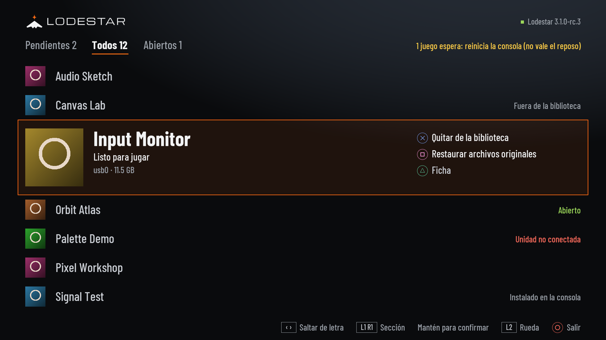
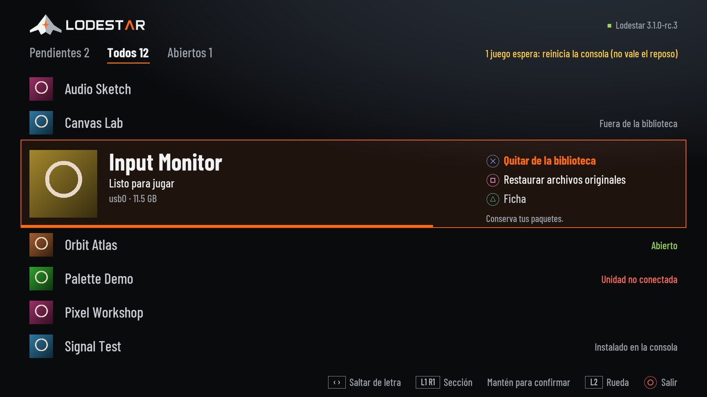
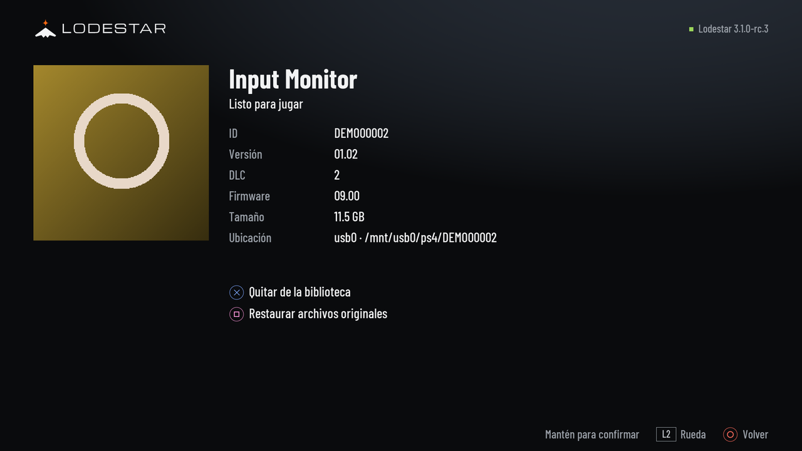
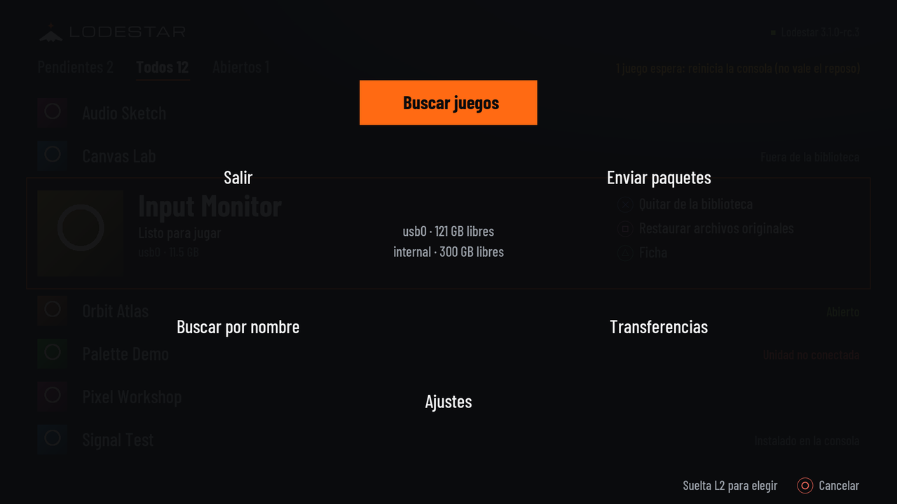
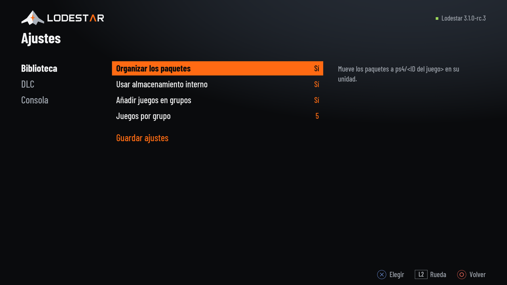
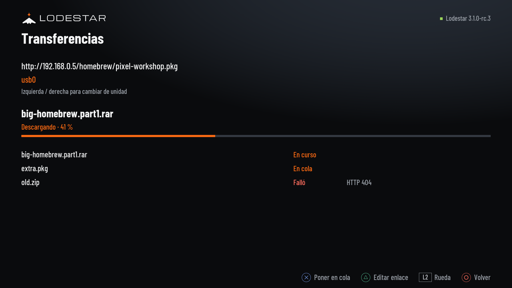
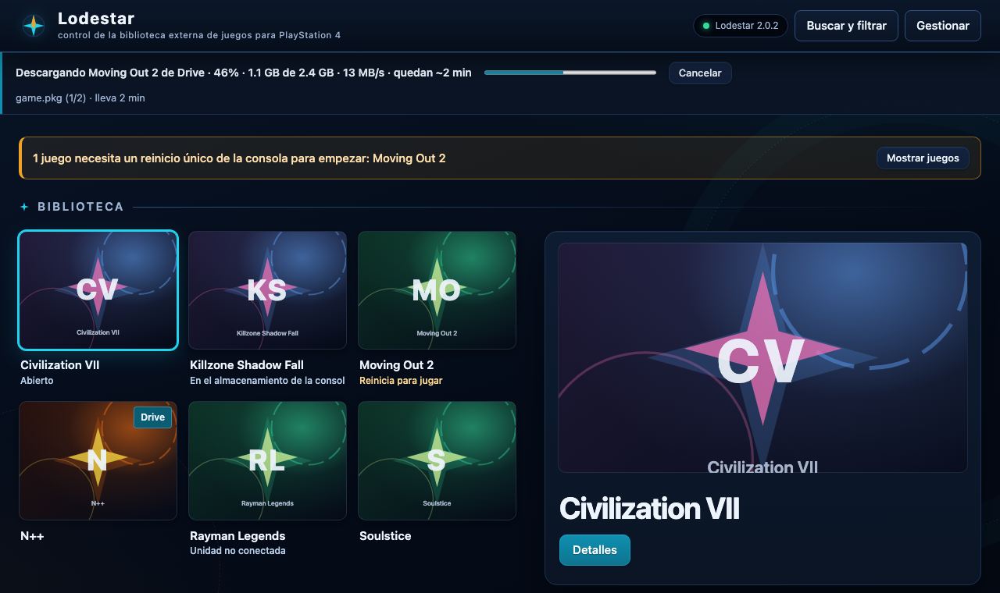
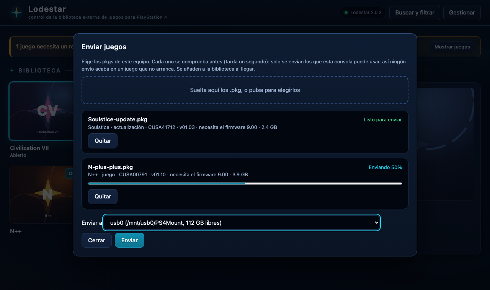
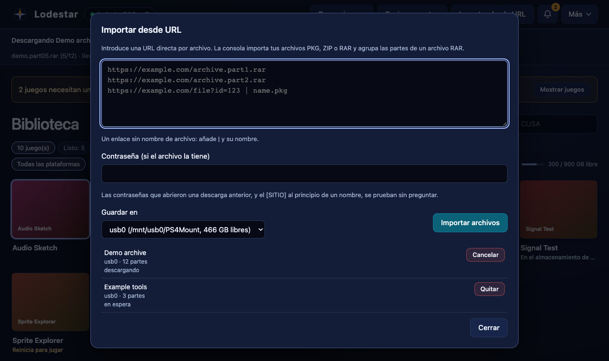

# Guía de uso de Lodestar

[English](guide.md) · [Volver al README](../README.md)

Esta guía describe **Lodestar 3.1.0-rc.3**, una [versión de prueba](https://github.com/felipebasurto/Lodestar-PS4/releases/tag/v3.1.0-rc.3): los controles nuevos aún no se han probado en una PS4 real.

- [Qué es cada pieza](#qué-es-cada-pieza)
- [Primera vez, paso a paso](#primera-vez-paso-a-paso)
- [Dónde poner los juegos](#dónde-poner-los-juegos)
- [La app de PS4 y sus controles](#la-app-de-ps4-y-sus-controles)
- [El panel web](#el-panel-web)
- [Estados de un juego](#estados-de-un-juego)
- [Quitar, restaurar y borrar](#quitar-restaurar-y-borrar)
- [Tareas habituales](#tareas-habituales)
- [Si algo falla](#si-algo-falla)

## Qué es cada pieza

| Pieza | Qué es | Para qué la usas |
| --- | --- | --- |
| **Lodestar** (el payload, `lodestar-ps4.bin`) | El programa que hace el trabajo en la consola | Cargarlo después de cada arranque. Sin él no funciona nada de lo demás |
| **La app de PS4** (`lodestar-panel.pkg`) | Un icono en la pantalla de inicio | El día a día en la tele, con el mando |
| **El panel web** (`http://<IP de la PS4>:8780`) | Una página que sirve el propio Lodestar | Desde el móvil o el PC: enviar paquetes y usar todos los ajustes |
| **La extensión** (`lodestar-extension.zip`) | Una extensión para el navegador del PC | Mandar a la consola lo que ibas a descargar en el PC. Opcional |

Cerrar la app no detiene Lodestar.

## Primera vez, paso a paso

Necesitas una PS4 con jailbreak y GoldHEN, y paquetes `.pkg` que tengas derecho a usar. Para jugar desde USB, un disco en **exFAT**.

1. Copia `lodestar-ps4.bin` a `/data/payloads/` de la consola (por FTP, por ejemplo).
2. Carga el payload desde el Payloader de GoldHEN o desde Payload Guest. Sale una notificación con la dirección del panel.
3. La app se instala sola unos segundos después, si la consola tiene internet y existe una release de esa versión, y se abre en el primer arranque. Si no aparece, instala `lodestar-panel.pkg` con el instalador de paquetes de GoldHEN. Se llama **Lodestar** en la pantalla de inicio.
4. **Elige los ajustes y guarda.** En el primer arranque no se añade ningún juego existente hasta que guardas explícitamente (no hay guardado automático por tiempo). En la app: mantén **L2**, elige **Ajustes**, revisa y baja hasta **Guardar ajustes**, o hazlo desde el panel web.
5. Pon los juegos como explica [la sección siguiente](#dónde-poner-los-juegos) y conecta el USB.
6. Si un juego queda como **Reinicia para jugar**, reinicia la consola una vez (**el modo reposo no vale**) y vuelve a cargar Lodestar.
7. Juega desde la pantalla de inicio, como con cualquier otro juego.

**Después de cada arranque** de la consola hay que cargar Lodestar otra vez. Para que se cargue solo, activa **Ajustes → Consola → Arrancar con GoldHEN** (el `.bin` tiene que estar en `/data/payloads/`).

## Dónde poner los juegos

El juego, su actualización y sus DLC pueden ir juntos en cualquiera de estos sitios:

- **USB:** en la carpeta **`Lodestar`** de la unidad (se aceptan subcarpetas).
- **Memoria de la consola:** en `/data/Lodestar`.
- **Por la red:** con **Enviar paquetes** desde el panel web.

> [!IMPORTANT]
> Con **Organizar los paquetes** activado (es lo predeterminado), Lodestar **mueve y renombra** cada `.pkg` a `ps4/<ID del juego>/` en la misma unidad. Si prefieres que no toque tus archivos, desactívalo **antes de guardar los primeros ajustes**. **Restaurar archivos originales** devuelve cada paquete a su sitio y con su nombre.

Para buscar en otras carpetas, usa el panel web: **Más → Ajustes → Carpetas donde buscar pkgs**.

## La app de PS4 y sus controles

### Controles de un vistazo

| Botón | En la biblioteca | En otras pantallas |
| --- | --- | --- |
| **↑ ↓** o stick izquierdo | Juego anterior o siguiente | Moverse por las opciones |
| **← →** | Saltar a la inicial anterior o siguiente | En Ajustes, entrar y salir de las opciones; en Transferencias, elegir unidad |
| **L1 / R1** | Cambiar de sección | |
| **✕** (mantener) | Añadir o quitar el juego | En la ficha, lo mismo |
| **✕** (pulsar) | Reconectar, si se perdió la conexión | Elegir, cambiar un valor, poner en cola |
| **□** (mantener) | Restaurar los archivos originales | En la ficha, lo mismo |
| **△** | Abrir la ficha del juego | Cerrar la ficha; en Transferencias, editar el enlace |
| **L2** (mantener) | Abrir la rueda | Abre la rueda desde cualquier pantalla |
| **○** | Borrar la búsqueda; si no hay, salir | Volver |

Mantener pulsado un botón de dirección repite el movimiento. La franja inferior de cada pantalla recuerda los botones disponibles.

**Mantener para confirmar:** añadir, quitar y restaurar necesitan mantener el botón unos 0,7 segundos, mientras se llena una barra naranja. Si lo sueltas antes, no pasa nada.

### Biblioteca

Los juegos van en una sola columna, ordenados por título. El elegido se amplía y muestra su estado, unidad, tamaño y lo que puedes hacer con él. Un juego sin etiqueta está listo para jugar.

Arriba hay tres secciones, con el número de juegos de cada una:

- **Pendientes:** los que esperan un reinicio o a ser añadidos, los de una unidad desconectada, los que tienen otra copia activa y los de estado desconocido.
- **Todos:** la biblioteca entera. La app abre aquí.
- **Abiertos:** el juego que está en marcha.

### Ficha del juego

Pulsa **△**. Muestra ID, versión, número de DLC, firmware que necesita, tamaño y dónde están los archivos, y el aviso si hay algún problema (por ejemplo, una actualización que no se puede usar). **○** o **△** vuelven.

### La rueda (L2)

1. **Mantén L2.**
2. **Apunta** con cualquiera de los sticks, o recorre las opciones con las flechas.
3. **Suelta L2** para elegir (también vale **✕**).

Para salir sin hacer nada, pulsa **○**, o suelta L2 antes de apuntar. En el centro se ve el espacio libre de cada unidad.

| Opción | Qué hace |
| --- | --- |
| **Buscar juegos** | Vuelve a mirar las unidades |
| **Enviar paquetes** | Muestra la dirección del panel para abrirlo en el móvil o el PC |
| **Transferencias** | Descargar desde una URL y ver la cola |
| **Ajustes** | Los ajustes habituales |
| **Buscar por nombre** | Abre el teclado; filtra por título o ID |
| **Salir** | Cierra la app (Lodestar sigue en marcha) |

Mientras Lodestar está aplicando un cambio, Buscar juegos, Transferencias y Ajustes esperan.

### Buscar por nombre

Elige **Buscar por nombre** en la rueda y escribe parte del título o del ID. La búsqueda aparece arriba a la derecha y se aplica a las tres secciones. **○** la borra.

### Ajustes

Con **↑ ↓** eliges una categoría y con **✕** o **→** entras. Dentro, **✕** o **→** cambian el valor y **←** vuelve a las categorías. **Nada se aplica hasta que eliges Guardar ajustes** y pulsas **✕**. **○** sale sin guardar.

| Categoría | Ajuste | Qué hace | Por defecto |
| --- | --- | --- | --- |
| Biblioteca | Organizar los paquetes | Mueve cada paquete a `ps4/<ID>/` en su unidad | Sí |
| Biblioteca | Usar almacenamiento interno | Busca también en `/data/Lodestar` | Sí |
| Biblioteca | Añadir juegos en grupos | Registra pocos a la vez cuando hay muchos | Sí |
| Biblioteca | Juegos por grupo | Tamaño de cada grupo (1 a 50) | 5 |
| DLC | Modo de DLC | **Unidad de origen**: se usan desde su unidad. **Instalar en consola**: ocupan memoria interna. **Desactivado**: no se usan | Unidad de origen |
| DLC | Instalar DLC grandes | Al instalar en consola, también los de más de 256 MB | Sí |
| Consola | Idioma | Consola, inglés o español | Consola |
| Consola | Arrancar con GoldHEN | Carga Lodestar al arrancar GoldHEN | No |
| Consola | Leer eventos de consola | Detecta cuándo se abre y se cierra un juego. Desactívalo si otro payload necesita el log (AnyPad, por ejemplo) | Sí |

Las carpetas donde buscar, los grupos al restaurar y la restauración de todos los juegos están en el panel web.

### Enviar paquetes

Muestra una dirección del tipo `http://192.168.1.50:8780`. Ábrela en el móvil o el PC, en la misma red, y envía los archivos desde allí. La app no envía archivos por sí misma.

### Transferencias

Para descargar en la consola un `.pkg`, `.zip` o `.rar` desde una URL directa:

1. Pulsa **✕** y escribe la URL (`http://` o `https://`).
2. Elige la unidad con **← →**, si hay más de una.
3. Pulsa **✕** para ponerla en cola. **△** edita el enlace.

Debajo se ven la descarga en curso y las siguientes. Cancelar, reintentar, escribir la contraseña de un archivo comprimido o ver la cola completa se hace en el panel web.

### Si la app dice que Lodestar no está en marcha

Carga el payload y pulsa **✕**. La app también reintenta sola cada pocos segundos.

## El panel web

Abre `http://<IP de la PS4>:8780` desde un equipo de tu red. **No tiene contraseña:** úsalo solo en una red de confianza.

- **Arriba:** Buscar juegos, Enviar paquetes, Importar desde URL, las notificaciones y **Más** (Ajustes, Quitar varios, Log y Detener).
- **Encima de la lista:** el buscador, los filtros por estado y por plataforma, y el espacio libre de cada unidad.
- **La lista:** un juego por fila. Al pulsar uno se abre su ficha, y **en la ficha están las acciones**: añadir, quitar y restaurar. Aquí no hace falta mantener pulsado; restaurar pide confirmación.

En un ordenador, las flechas recorren la lista y **Intro** abre la ficha. En el navegador de la PS4, la cruceta o el stick izquierdo mueven, **✕** elige y **○** vuelve.

## Estados de un juego

La app y el panel web usan los mismos nombres. Al abrir un juego que necesita atención, ahí mismo dice qué hacer.

| Estado | Qué significa | Qué hacer |
| --- | --- | --- |
| **Listo para jugar** (sin etiqueta en la lista) | Se puede jugar | Nada |
| **Reinicia para jugar** | La consola lo prepara al arrancar | Reiniciar una vez (**el modo reposo no vale**) y tener Lodestar cargado después |
| **Abierto** | El juego está en marcha | Ciérralo para quitarlo |
| **Pendiente de añadir** | Lodestar todavía tiene que añadirlo | Esperar; si sigue así, mirar el log |
| **Fuera de la biblioteca** | Lo quitaste | **Añadir a la biblioteca** cuando quieras |
| **Unidad no conectada** | Falta el disco con sus paquetes | Conectarlo |
| **Instalado en la consola** | Está instalado de la forma normal. Lodestar no lo toca | Nada |
| **Hay otra copia activa** | Se está usando otra copia del mismo juego | Dejar una sola |

Mientras haya juegos esperando un reinicio, la app y el panel lo avisan encima de la biblioteca.

## Quitar, restaurar y borrar

Son tres cosas distintas. **Solo la última borra archivos.**

| Acción | Cómo | El juego | Tus paquetes |
| --- | --- | --- | --- |
| **Quitar de la biblioteca** | App: mantener **✕**. Panel: en la ficha | Sale de la pantalla de inicio | Se quedan donde están |
| **Restaurar archivos originales** | App: mantener **□**. Panel: en la ficha | Sale de la pantalla de inicio | Vuelven a su carpeta y nombre originales |
| **Borrar en la consola** (Options → Borrar) | Desde la pantalla de inicio de la PS4 | Desaparece | **Se borran** |

> [!CAUTION]
> Al borrar desde la pantalla de inicio un juego añadido por Lodestar, se borra **su carpeta `ps4/<ID>/` entera**, con la actualización, los DLC y cualquier otra cosa que haya dentro. Los paquetes usados donde tú los dejaste (con Organizar desactivado, fuera de esa carpeta) se conservan. Si solo quieres que deje de verse, usa **Quitar de la biblioteca**.

La opción de restaurar no aparece si Lodestar no movió nada (Organizar desactivado).

## Tareas habituales

**Añadir un juego nuevo.** Copia los paquetes en la carpeta `Lodestar` del USB y conéctalo. Si ya estaba conectado, usa **Buscar juegos**. Reinicia si lo pide.

**Añadir una actualización o un DLC.** Copia el paquete igual que el juego y usa **Buscar juegos**. Una actualización que llega después del juego puede pedir un reinicio.

**Enviar paquetes desde el PC.** En el panel, **Enviar paquetes**, elige o arrastra el `.pkg`, y elige la unidad. Se comprueba antes de enviarlo que la consola puede usarlo.

**Importar desde una URL.** En el panel, **Importar desde URL**, pega la dirección directa y elige la unidad. Admite `.pkg`, `.zip` y `.rar` (también en partes, una URL por línea, y con contraseña). Una descarga interrumpida sigue al volver a cargar Lodestar.

**Usar la extensión del navegador.** Descomprime `lodestar-extension.zip`, cárgala en el navegador (en Chrome o Brave: Extensiones → Modo de desarrollador → Cargar descomprimida), escribe la IP de la consola, pulsa **Conectar**, elige dónde guardar y activa **Transferir archivos PKG, ZIP y RAR a la consola**.

**Desconectar un USB.** Cierra antes el juego que esté usando esa unidad y espera a que acaben las transferencias. Sus juegos quedan como **Unidad no conectada** hasta que la vuelvas a conectar.

**Detener Lodestar.** En el panel web, **Más → Detener**.

## Si algo falla

- **El panel no abre:** comprueba que salió la notificación de arranque y que usas la IP de la consola con el puerto `8780`.
- **No aparece un juego:** comprueba que está en la carpeta `Lodestar` (o en una de las configuradas) y usa **Buscar juegos**.
- **No se añade ningún juego la primera vez:** faltan por guardar los ajustes.
- **Un juego pide reinicio una y otra vez, o no arranca:** copia `/data/lodestar/log.txt` por FTP y ejecuta `python3 tools/logcheck.py log.txt`, que lo explica en lenguaje llano.
- **Tienes también PS4Mount:** detenlo antes de cargar Lodestar; no pueden funcionar a la vez.

Para informar de un problema, abre una [issue](https://github.com/felipebasurto/Lodestar-PS4/issues) con el firmware, la versión y las líneas del log (revisa que no lleven datos personales).

Las capturas de la app usan juegos de ejemplo y se han generado en un PC con el código de dibujo de la app, no en una consola.
