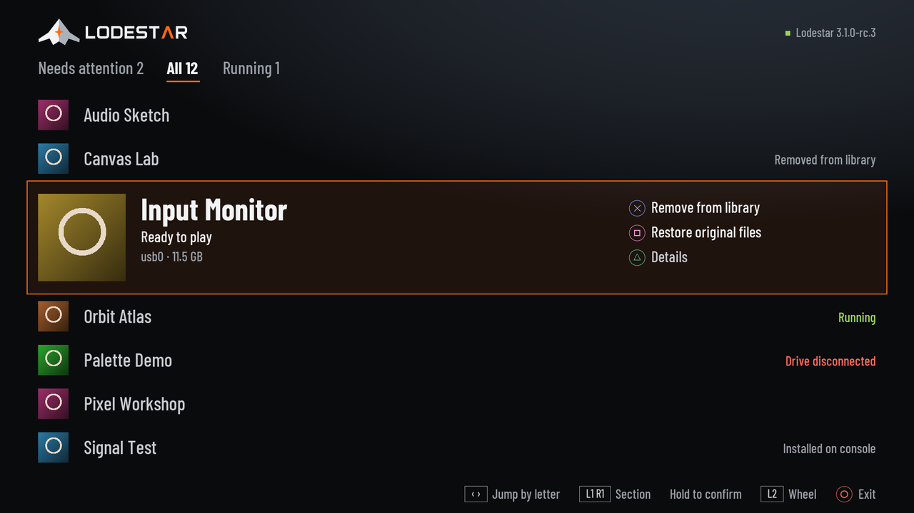
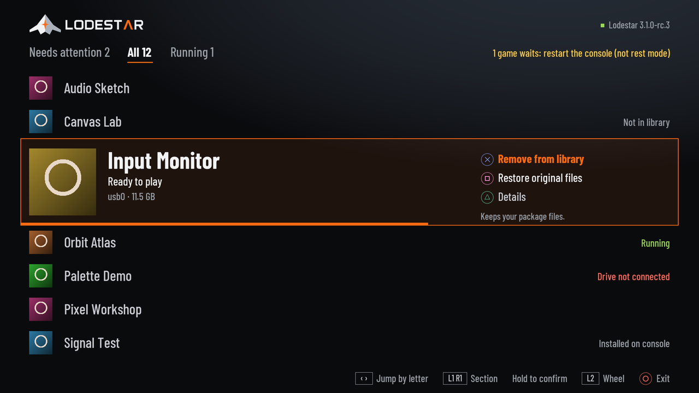
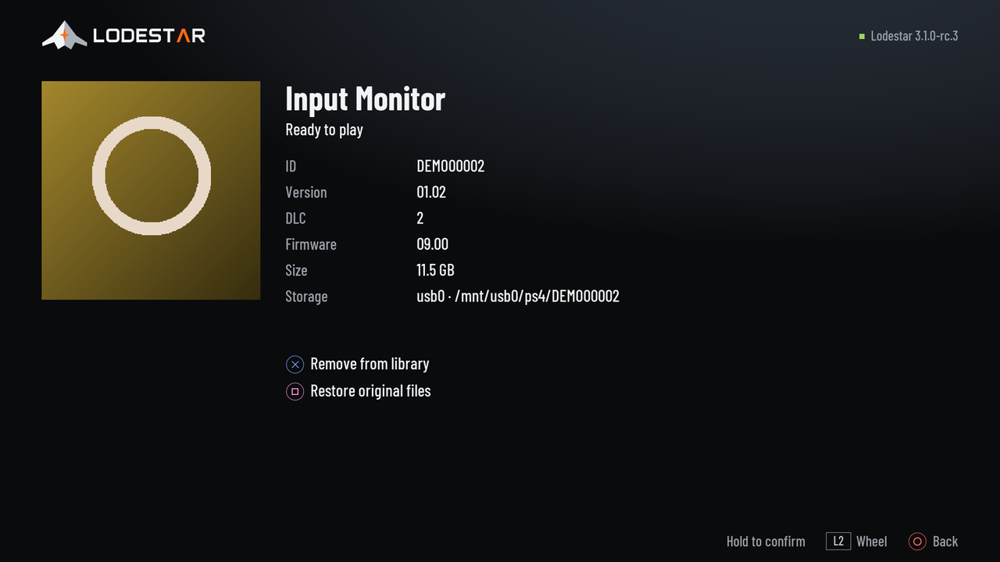
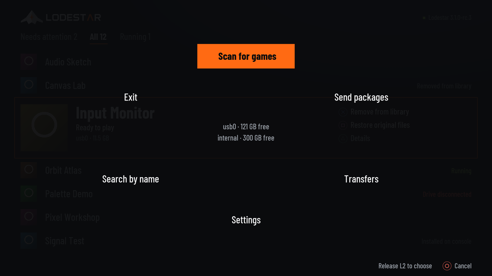
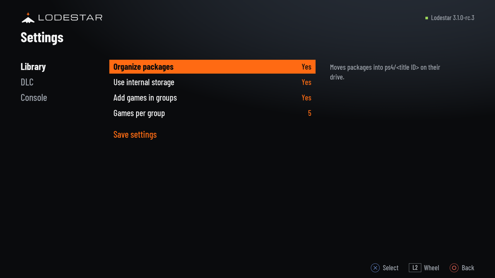
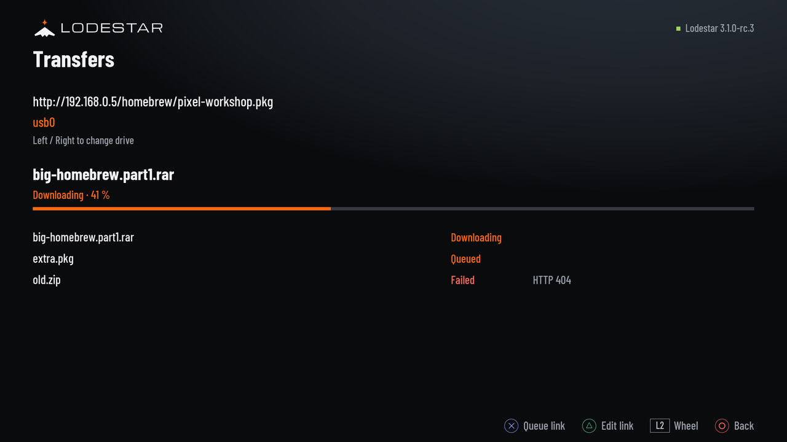
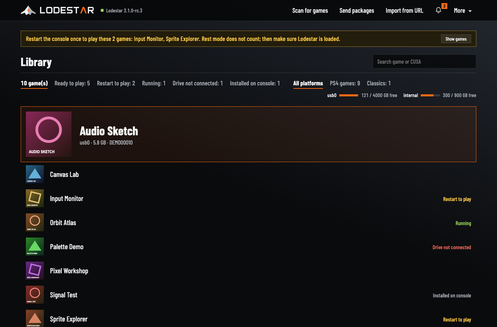

# Lodestar user guide

[Español](guia.md) · [Back to the README](../README.md)

This guide describes **Lodestar 3.1.0-rc.3**, a [test release](https://github.com/felipebasurto/Lodestar-PS4/releases/tag/v3.1.0-rc.3): the new controls have not been tried on a real PS4 yet.

- [The pieces](#the-pieces)
- [First time, step by step](#first-time-step-by-step)
- [Where to put games](#where-to-put-games)
- [The PS4 app and its controls](#the-ps4-app-and-its-controls)
- [The web panel](#the-web-panel)
- [Game states](#game-states)
- [Remove, restore and delete](#remove-restore-and-delete)
- [Common tasks](#common-tasks)
- [When something fails](#when-something-fails)

## The pieces

| Piece | What it is | What you use it for |
| --- | --- | --- |
| **Lodestar** (the payload, `lodestar-ps4.bin`) | The program that does the work on the console | Load it after every boot. Nothing else works without it |
| **The PS4 app** (`lodestar-panel.pkg`) | A tile on the home screen | Everyday use on the TV, with the controller |
| **The web panel** (`http://<PS4 IP>:8780`) | A page served by Lodestar itself | From a phone or PC: send packages and reach every setting |
| **The extension** (`lodestar-extension.zip`) | A desktop browser extension | Send to the console what you were about to download on the PC. Optional |

Closing the app does not stop Lodestar.

## First time, step by step

You need a jailbroken PS4 with GoldHEN, and `.pkg` files you are allowed to use. To play from USB, a drive formatted as **exFAT**.

1. Copy `lodestar-ps4.bin` to `/data/payloads/` on the console (over FTP, for example).
2. Load the payload with GoldHEN's Payloader or with Payload Guest. A notification shows the panel address.
3. The app installs itself a few seconds later, if the console has internet and there is a release for that version, and opens on the first start. If it does not appear, install `lodestar-panel.pkg` with GoldHEN's Package Installer. It is called **Lodestar** on the home screen.
4. **Choose the settings and save.** On the first start no existing game is added until you explicitly save (there is no timed auto-save fallback). In the app: hold **L2**, choose **Settings**, review them and go down to **Save settings**, or save from the web panel.
5. Add games as described in [the next section](#where-to-put-games) and connect the drive.
6. If a game shows **Restart to play**, restart the console once (**rest mode does not count**) and load Lodestar again.
7. Play from the home screen, like any other game.

**After every boot** Lodestar has to be loaded again. To load it automatically, turn on **Settings → Console → Start with GoldHEN** (the `.bin` must be in `/data/payloads/`).

## Where to put games

A game, its update and its add-ons can go together in any of these places:

- **USB:** the drive's **`Lodestar`** folder (subfolders are fine).
- **Console storage:** `/data/Lodestar`.
- **Over the network:** **Send packages** in the web panel.

> [!IMPORTANT]
> With **Organize packages** on (the default), Lodestar **moves and renames** each `.pkg` to `ps4/<title ID>/` on the same drive. If you would rather it left your files alone, turn it off **before saving the first settings**. **Restore original files** puts every package back where it was, with its name.

To search other folders, use the web panel: **More → Settings → Folders to search for pkgs**.

## The PS4 app and its controls

### Controls at a glance

| Button | In the library | On other screens |
| --- | --- | --- |
| **↑ ↓** or left stick | Previous or next game | Move through the options |
| **← →** | Jump to the previous or next initial | In Settings, enter and leave the options; in Transfers, choose the drive |
| **L1 / R1** | Change section | |
| **Cross** (hold) | Add or remove the game | The same in the details |
| **Cross** (press) | Reconnect, when the connection is lost | Choose, change a value, queue |
| **Square** (hold) | Restore the original files | The same in the details |
| **Triangle** | Open the game's details | Close the details; in Transfers, edit the link |
| **L2** (hold) | Open the wheel | Opens the wheel from any screen |
| **Circle** | Clear the search; with none, exit | Back |

Holding a direction repeats it. The strip at the bottom of each screen shows the buttons you can use.

**Hold to confirm:** adding, removing and restoring need the button held for about 0.7 seconds while an orange bar fills. Release it earlier and nothing happens.

### Library

Games are listed in one column, in title order. The chosen one grows and shows its state, drive, size and what you can do with it. A game with no label is ready to play.

Three sections sit at the top, each with its number of games:

- **Needs attention:** games waiting for a restart or to be added, with a disconnected drive, with another active copy, or in an unknown state.
- **All:** the whole library. The app opens here.
- **Running:** the game that is open.

### Game details

Press **Triangle**. It shows the ID, version, number of add-ons, required firmware, size and where the files are, plus a warning when something is wrong (for instance, an update that cannot be used). **Circle** or **Triangle** go back.

### The wheel (L2)

1. **Hold L2.**
2. **Point** with either stick, or step through the options with the arrows.
3. **Release L2** to choose (**Cross** works too).

To leave without doing anything, press **Circle**, or release L2 before pointing. The centre shows the free space of each drive.

| Option | What it does |
| --- | --- |
| **Scan for games** | Looks at the drives again |
| **Send packages** | Shows the panel address to open on a phone or PC |
| **Transfers** | Download from a URL and see the queue |
| **Settings** | The usual settings |
| **Search by name** | Opens the keyboard; filters by title or ID |
| **Exit** | Closes the app (Lodestar keeps running) |

While Lodestar is applying a change, Scan for games, Transfers and Settings wait.

### Search by name

Choose **Search by name** on the wheel and type part of the title or ID. The search shows at the top right and applies to all three sections. **Circle** clears it.

### Settings

Use **↑ ↓** to pick a category and **Cross** or **→** to enter it. Inside, **Cross** or **→** change the value and **←** goes back to the categories. **Nothing is applied until you choose Save settings** and press **Cross**. **Circle** leaves without saving.

| Category | Setting | What it does | Default |
| --- | --- | --- | --- |
| Library | Organize packages | Moves each package to `ps4/<ID>/` on its drive | Yes |
| Library | Use internal storage | Also searches `/data/Lodestar` | Yes |
| Library | Add games in groups | Registers a few at a time when there are many | Yes |
| Library | Games per group | Size of each group (1 to 50) | 5 |
| DLC | Add-on mode | **Source drive**: used from their drive. **Install internally**: they take console storage. **Off**: not used | Source drive |
| DLC | Install large add-ons | When installing internally, also those over 256 MB | Yes |
| Console | Language | Console, English or Spanish | Console |
| Console | Start with GoldHEN | Loads Lodestar when GoldHEN starts | No |
| Console | Read console events | Detects when a game starts and stops. Turn it off if another payload needs the log (AnyPad, for example) | Yes |

The folders to search, the group size when restoring and restoring every game are in the web panel.

### Send packages

It shows an address such as `http://192.168.1.50:8780`. Open it on a phone or PC on the same network and send the files from there. The app does not send files itself.

### Transfers

To download a `.pkg`, `.zip` or `.rar` to the console from a direct URL:

1. Press **Cross** and type the URL (`http://` or `https://`).
2. Choose the drive with **← →**, when there is more than one.
3. Press **Cross** to queue it. **Triangle** edits the link.

The current download and the next ones show below. Cancelling, retrying, typing an archive's password or seeing the whole queue is done in the web panel.

### If the app says Lodestar is not running

Load the payload and press **Cross**. The app also retries by itself every few seconds.

## The web panel

Open `http://<PS4 IP>:8780` from a device on your network. **It has no password:** use it only on a network you trust.

- **Top:** Scan for games, Send packages, Import from URL, notifications and **More** (Settings, Remove several, Log and Stop).
- **Above the list:** the search field, the filters by state and platform, and each drive's free space.
- **The list:** one game per row. Choosing one opens its details, and **the actions are in the details**: add, remove and restore. There is nothing to hold here; restoring asks for confirmation.

On a computer, the arrows walk the list and **Enter** opens the details. In the PS4's browser, the D-pad or left stick move, **Cross** chooses and **Circle** goes back.

## Game states

The app and the web panel use the same names. Opening a game that needs attention tells you what to do.

| State | What it means | What to do |
| --- | --- | --- |
| **Ready to play** (no label in the list) | It can be played | Nothing |
| **Restart to play** | The console prepares it at boot | Restart once (**rest mode does not count**) and have Lodestar loaded afterwards |
| **Running** | The game is open | Close it to remove it |
| **Waiting to be added** | Lodestar still has to add it | Wait; if it stays like this, read the log |
| **Not in library** | You removed it | **Add to library** whenever you like |
| **Drive not connected** | The drive with its packages is missing | Connect it |
| **Installed on console** | Installed the normal way. Lodestar leaves it alone | Nothing |
| **Another copy is active** | Another copy of the same game is in use | Keep only one |

While any game waits for a restart, the app and the panel say so above the library.

## Remove, restore and delete

These are three different things. **Only the last one deletes files.**

| Action | How | The game | Your packages |
| --- | --- | --- | --- |
| **Remove from library** | App: hold **Cross**. Panel: in the details | Leaves the home screen | Stay where they are |
| **Restore original files** | App: hold **Square**. Panel: in the details | Leaves the home screen | Go back to their original folder and name |
| **Delete on the console** (Options → Delete) | From the PS4 home screen | Disappears | **Are deleted** |

> [!CAUTION]
> Deleting a Lodestar-added game from the home screen deletes **its whole `ps4/<ID>/` folder**, with the update, the add-ons and anything else inside. Packages used where you left them (with Organize off, outside that folder) are kept. If you only want it out of sight, use **Remove from library**.

Restore is not offered when Lodestar moved nothing (Organize off).

## Common tasks

**Add a new game.** Copy the packages into the drive's `Lodestar` folder and connect it. If it was already connected, use **Scan for games**. Restart if asked.

**Add an update or an add-on.** Copy the package the same way and use **Scan for games**. An update that arrives after the game may ask for a restart.

**Send packages from a PC.** In the panel, **Send packages**, pick or drag the `.pkg` and choose the drive. It is checked before sending that the console can use it.

**Import from a URL.** In the panel, **Import from URL**, paste the direct address and choose the drive. It takes `.pkg`, `.zip` and `.rar` (also in parts, one URL per line, and with a password). An interrupted download carries on when Lodestar is loaded again.

**Use the browser extension.** Unzip `lodestar-extension.zip`, load it in the browser (Chrome or Brave: Extensions → Developer mode → Load unpacked), type the console's IP, connect, choose where to save and turn on the transfer of PKG, ZIP and RAR files.

**Unplug a USB drive.** First close any game using that drive and let transfers finish. Its games show **Drive disconnected** until you connect it again.

**Stop Lodestar.** In the web panel, **More → Stop**.

## When something fails

- **The panel does not open:** check that the startup notification appeared and that you use the console's IP with port `8780`.
- **A game does not appear:** check that it is in the `Lodestar` folder (or one you configured) and use **Scan for games**.
- **No game is added the first time:** the settings have not been saved yet.
- **A game keeps asking for a restart, or does not start:** copy `/data/lodestar/log.txt` over FTP and run `python3 tools/logcheck.py log.txt --lang en`, which explains it in plain words.
- **You also have PS4Mount:** stop it before loading Lodestar; they cannot run together.

To report a problem, open an [issue](https://github.com/felipebasurto/Lodestar-PS4/issues) with the firmware, the version and the log lines (check that they carry nothing personal).

The app screenshots use example games and were generated on a computer with the app's drawing code, not on a console.
